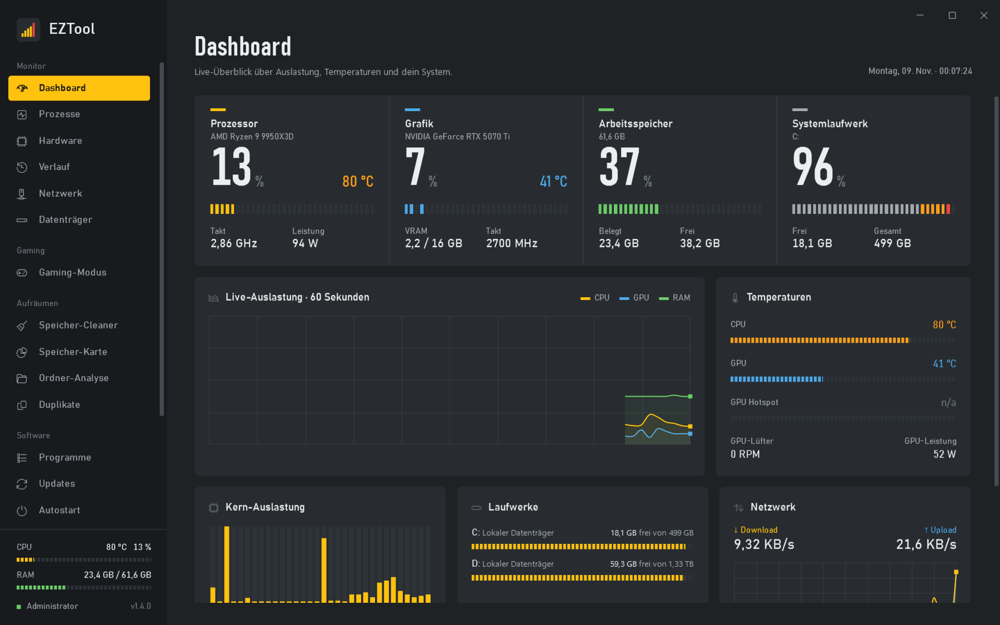
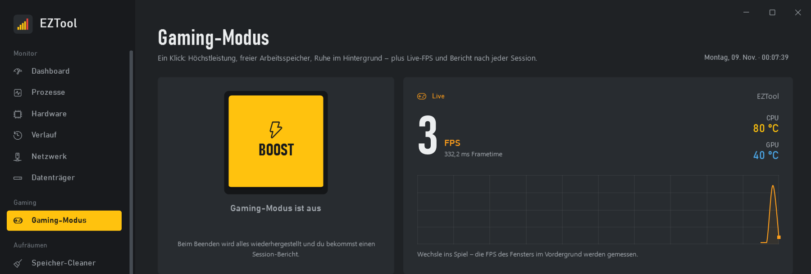
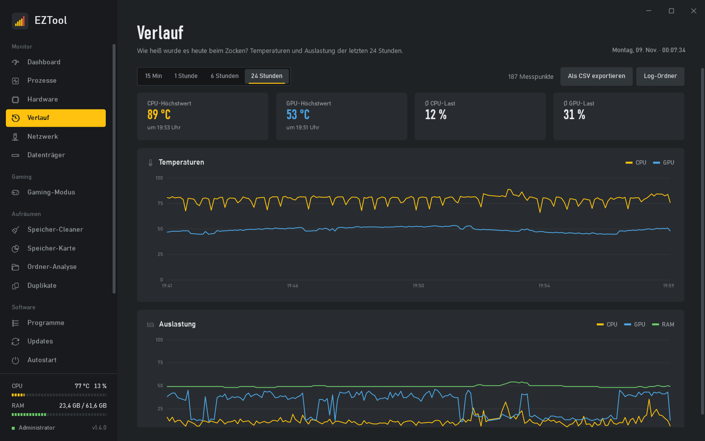
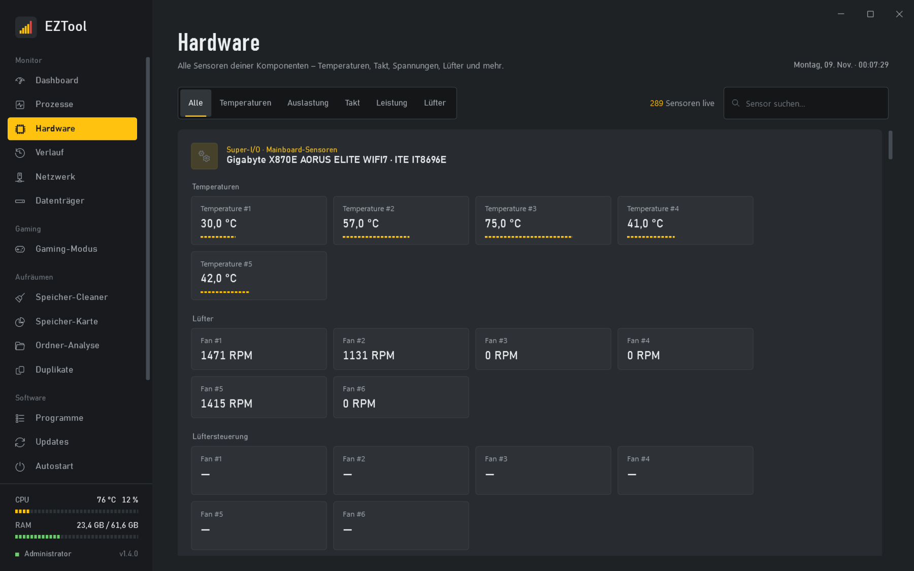
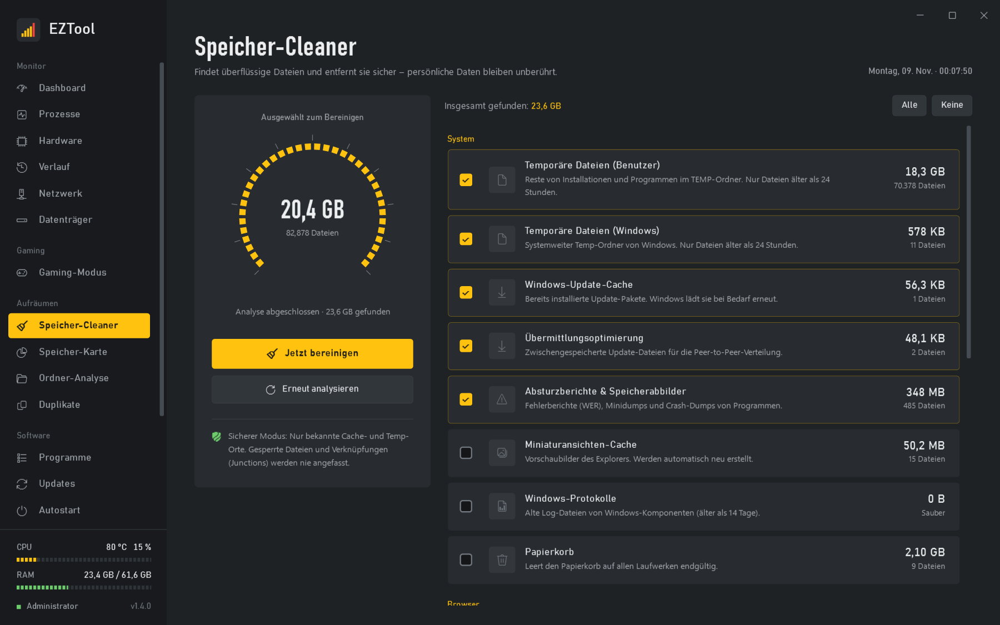
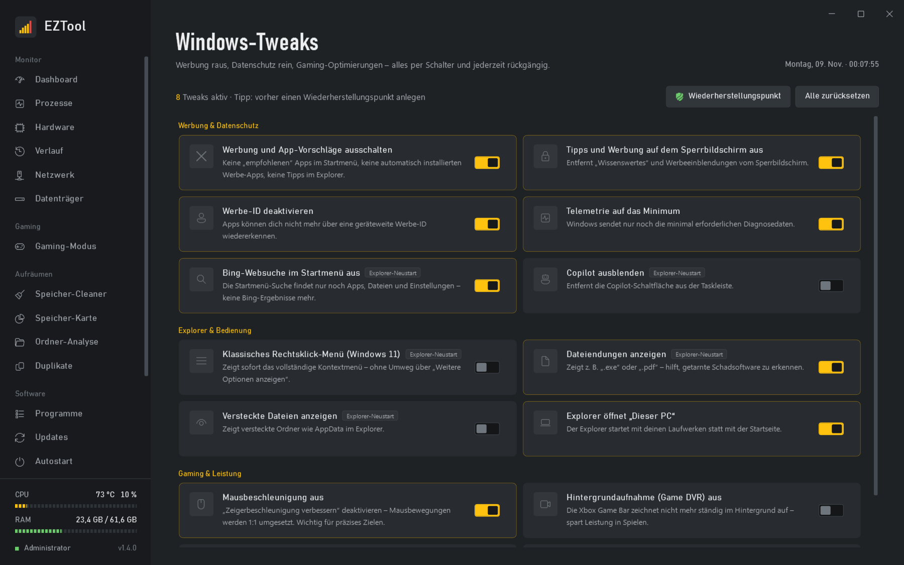
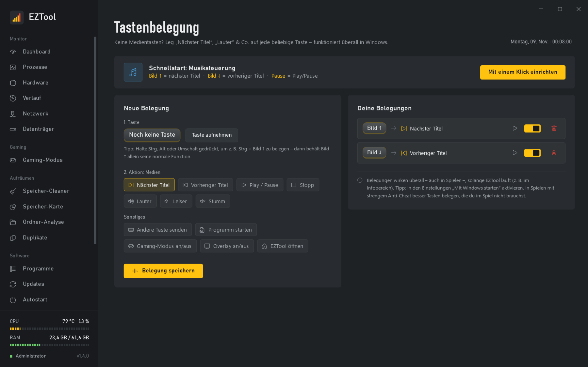
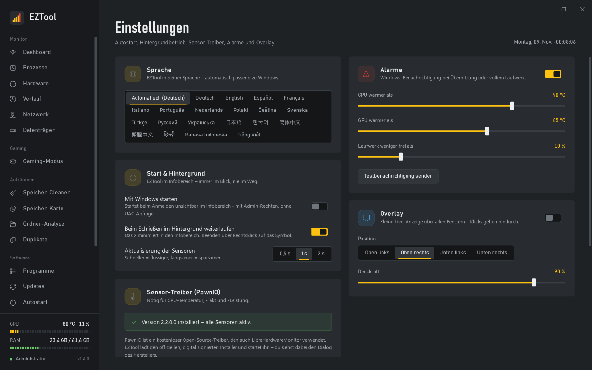
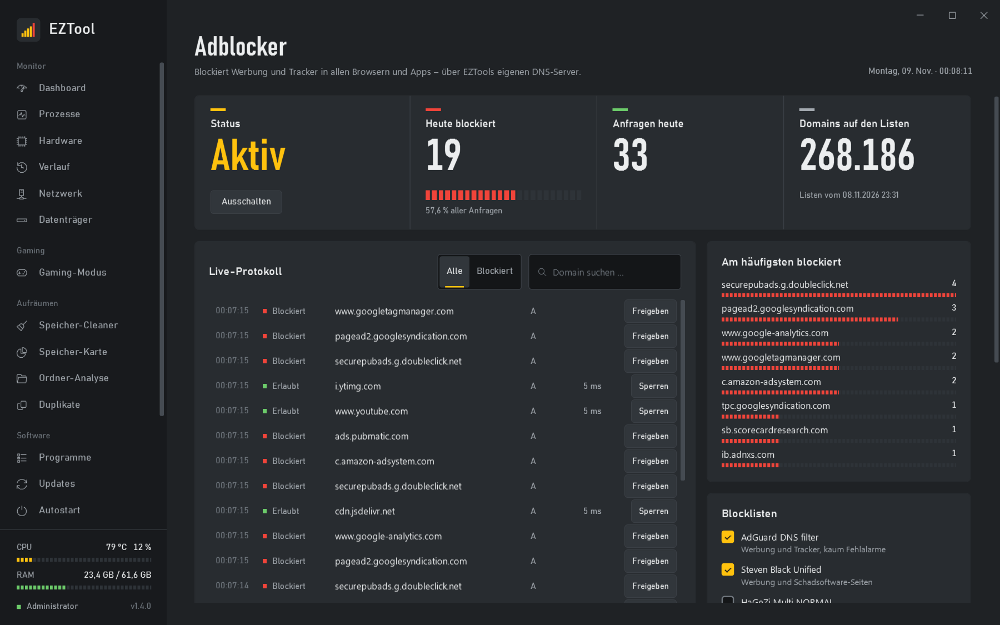
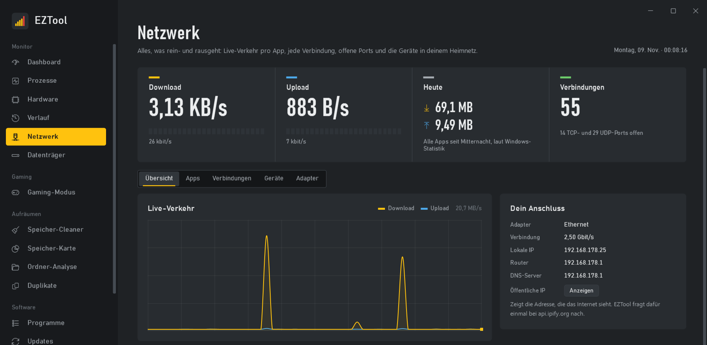

#  EZTool

[English](README.md) · **Deutsch**

[](https://github.com/sweeax-exe/EZTool/releases/latest)
[](LICENSE)


System-Tool für Windows 10/11, das aussieht und sich liest wie ein Messgerät: Hardware-Monitoring mit FPS, Gaming-Modus, Speicher-Cleaner, Deinstaller, Updates, Autostart, systemweiter Adblocker, Tweaks und Tastenbelegung. Kostenlos und Open Source.



## Screenshots

| | |
|---|---|
|  **Gaming-Modus**: Boost per Klick, Live-FPS, Session-Bericht |  **Verlauf**: Temperaturen und Auslastung der letzten 24 Stunden |
|  **Hardware**: alle Sensoren live, nach Bauteil gruppiert |  **Speicher-Cleaner**: sicher aufräumen, inklusive Tiefenreinigung |
|  **Windows-Tweaks**: Werbung raus, Gaming rein, alles umkehrbar |  **Tastenbelegung**: Medientasten für jede Tastatur |
|  **Einstellungen**: Sprache, Autostart, Alarme, Overlay, Auto-Update |  **Adblocker**: blockiert Werbung und Tracker in allen Browsern und Apps |
|  **Netzwerk**: Live-Verkehr pro App, jede Verbindung, Geräte im Heimnetz | |

## Download

1. Unter [**Releases**](https://github.com/sweeax-exe/EZTool/releases/latest) die Datei **`EZTool.exe`** herunterladen.
2. Starten, fertig. Keine Installation nötig, .NET ist bereits enthalten.

**Gut zu wissen:**
- **Administrator-Rechte:** EZTool fragt beim Start danach. Es braucht sie für Temperatursensoren, FPS-Messung, Tiefenreinigung und Deinstallationen.
- **SmartScreen:** Beim ersten Start kann Windows „Der Computer wurde durch Windows geschützt“ anzeigen, weil die EXE kein kostenpflichtiges Code-Signing-Zertifikat hat. Dann über **Weitere Informationen → Trotzdem ausführen** starten. Der komplette Quellcode liegt in diesem Repository, und jede EXE wird öffentlich von GitHub Actions gebaut.
- **Automatische Updates:** EZTool prüft regelmäßig auf neue Releases. Ein Update wird per SHA-256 geprüft und installiert, danach startet EZTool neu. Das lässt sich in den Einstellungen abschalten.

## 🌍 Sprachen

EZTool erkennt die Windows-Sprache automatisch. In den Einstellungen lässt sie sich jederzeit ändern.

Deutsch · English · Español · Français · Italiano · Português · Nederlands · Polski · Čeština · Svenska · Türkçe · Русский · Українська · 日本語 · 한국어 · 简体中文 · 繁體中文 · हिन्दी · Bahasa Indonesia · Tiếng Việt

**Sprache beitragen oder Übersetzung verbessern:**
1. Den Ordner `src/EZTool/Localization/en` nach `Localization/<code>` kopieren und die Texte übersetzen.
2. Platzhalter wie `{0}` nicht verändern.
3. Die Sprache in `Core/Loc.cs` bei `Languages` eintragen und einen Pull Request stellen.

Fehlt in einer Sprache ein Text, zeigt EZTool automatisch den englischen an.

## Module

Die Navigation ist in fünf Gruppen gegliedert:

| Gruppe | Modul | Was es kann |
|---|---|---|
| Monitor | **Dashboard** | Große Messwerte mit Segment-Pegelanzeigen für CPU, GPU, RAM und Systemlaufwerk, 60-Sekunden-Verlauf, Temperaturen, Kern-Auslastung, Laufwerke, Netzwerk, Systeminfos |
| | **Prozesse** | Prozesse nach Programm gruppiert (z. B. „Chrome 30ד), CPU und RAM live, mit einem Klick beenden. Windows-Kernprozesse sind geschützt |
| | **Hardware** | Alle Sensoren (oft 150+) nach Bauteil gruppiert, mit Filter und Suche |
| | **Verlauf** | Temperaturen, Auslastung und FPS der letzten 24 Stunden als Diagramm mit Fadenkreuz, Höchstwerte, CSV-Export |
| | **Netzwerk** | Live-Download und -Upload, Datenverbrauch pro App (heute, 7 oder 30 Tage), jede Verbindung mit App, Hostname und Datenmenge, offene Ports, Geräte im Heimnetz mit Hersteller, Adapter-Details |
| | **Datenträger** | SSD-/HDD-Gesundheit: Restlebensdauer, Temperatur, Betriebsstunden, geschriebene TB, Lese-/Schreibfehler |
| Gaming | **Gaming-Modus** | Boost-Knopf (Höchstleistung, Standby-RAM leeren, Windows Update anhalten, gewählte Apps schließen), Live-FPS, Session-Bericht mit Ø-FPS, 1 % Low und Höchsttemperaturen |
| Aufräumen | **Speicher-Cleaner** | Temp, Caches, Crash-Dumps, Browser, Papierkorb, dazu Tiefenreinigung (alte Windows-Updates per DISM, `Windows.old`) |
| | **Speicher-Karte** | Laufwerk als Treemap: Kacheln proportional zur Größe, zwei Ebenen, Klick zoomt hinein, Rechtsklick zurück |
| | **Ordner-Analyse** | Große und lange ungenutzte, verwaiste und leere Ordner |
| | **Duplikate** | Doppelte Dateien, verglichen über den echten Inhalt (SHA-256) |
| Software | **Programme** | Desktop-Programme und Store-Apps deinstallieren, danach die Reste entfernen |
| | **Updates** | Verfügbare Updates aller Programme über winget, einzeln oder alle mit einem Klick |
| | **Autostart** | Run-Keys, Autostart-Ordner und geplante Aufgaben ein- und ausschalten |
| System | **Windows-Tweaks** | 14 Schalter für Werbung, Datenschutz, Explorer und Gaming (Mausbeschleunigung, Game DVR …), jederzeit rückgängig, mit Wiederherstellungspunkt |
| | **Adblocker** | Systemweites Blockieren von Werbung und Trackern über EZTools eigenen DNS-Server: Blocklisten (AdGuard, Steven Black, HaGeZi), Live-Protokoll, Freigabe- und Sperrregeln, verschlüsseltes DNS (Cloudflare, Quad9, Google) |
| | **Tastenbelegung** | Medienfunktionen (Titel vor/zurück, Play/Pause, Lautstärke), andere Tasten, Programme oder EZTool-Aktionen auf beliebige Tasten legen, global, auch in Spielen. Schnellstart: Bild ↑/↓ = Titel vor/zurück |
| | **Einstellungen** | Sprache, mit Windows starten, Hintergrundbetrieb, Sensor-Treiber, Alarme, Overlay, Updates |

## Design

EZTool ist gebaut wie ein Prüfgerät, nicht wie ein Sci-Fi-HUD: deckendes Graphit-Gehäuse, ein **Signalgelb** für alles, was man bedient, große DIN-Ziffern (Bahnschrift) für Live-Werte und segmentierte Pegelanzeigen mit Peak-Hold statt leuchtender Ringe. Messkanäle tragen Oszilloskop-Farben: CPU gelb, GPU blau, RAM grün. Alle Farben, Fonts und Control-Styles stehen zentral in `Themes/Theme.xaml` (`Chassis`, `Panel`, `Well`, `Accent`, …).

## Hintergrundbetrieb

- **Tray-Symbol:** Das X minimiert in den Infobereich. Der Tooltip zeigt CPU/GPU/RAM live. Das Rechtsklick-Menü öffnet Module, schaltet Overlay und Gaming-Modus und beendet EZTool.
- **Mit Windows starten:** legt eine geplante Aufgabe mit höchsten Rechten an. Ein normaler Run-Eintrag würde an der UAC scheitern, weil EZTool Admin-Rechte braucht. Die Aufgabe startet EZTool unsichtbar mit `--tray`.
- **Alarme:** Eine Windows-Benachrichtigung erscheint, wenn CPU oder GPU über dem Grenzwert liegen (erst nach 5 Messungen in Folge, dann höchstens alle 10 Minuten) oder ein Laufwerk fast voll ist. Ein Klick auf die Meldung öffnet das passende Modul.
- **Overlay:** kleine Live-Anzeige über allen Fenstern mit CPU, GPU, RAM und **FPS**. Klicks gehen hindurch. Funktioniert über randlosen Spielen, nicht in exklusivem Vollbild.
- **Sensor-Log:** alle 5 Sekunden, tageweise als CSV unter `%LOCALAPPDATA%\EZTool\Logs`. Wird nach 30 Tagen automatisch gelöscht.
- **Nur eine Instanz:** Ein zweiter Start holt das laufende Fenster nach vorn.

## FPS-Messung

EZTool liest die DirectX-„Present“-Ereignisse über Windows-ETW, also dieselbe Quelle, die auch PresentMon nutzt. Gemessen wird das Fenster im Vordergrund. Das funktioniert mit DirectX 9 bis 12. Vulkan- und OpenGL-Spiele werden nur erfasst, wenn sie über DXGI präsentieren. Die Messung braucht Administrator-Rechte und läuft nur, solange das Overlay, die Gaming-Seite oder der Gaming-Modus aktiv ist. Session-Berichte liegen unter `%LOCALAPPDATA%\EZTool\Sessions`.

## Tastenbelegung

Ein globaler Low-Level-Tastatur-Hook (`WH_KEYBOARD_LL`) fängt die belegte Taste ab. Ihre normale Funktion entfällt, und stattdessen sendet EZTool per `SendInput` die gewünschte Aktion, z. B. die Medientaste „Nächster Titel“. Weitere Details:

- **Kein Leerlauf:** Der Hook ist nur aktiv, wenn mindestens eine Belegung eingeschaltet ist.
- **Keine Endlosschleife:** Selbst gesendete Tasten werden ignoriert.
- **Normale Rechte:** Programme, die per Taste gestartet werden, laufen über den Explorer mit normalen Rechten, nicht als Administrator.
- **Gespeichert** werden die Belegungen in `settings.json` (`KeyBindings`).

## Netzwerk

- **Live-Verkehr pro App und Verbindung:** EZTool liest die Windows-ETW-Quelle `Microsoft-Windows-Kernel-Network`. Jedes TCP- und UDP-Paket kommt mit Prozess-ID, Größe und Gegenstelle an, so zeigt EZTool, welche App mit welchem Server wie viel austauscht. Braucht Administrator-Rechte und läuft nur, solange die Netzwerk-Seite offen ist.
- **Hostnamen:** Gegenstellen werden mit den Namen abgeglichen, die Programme nachgeschlagen haben (Windows-DNS-Cache), sonst per Rückwärtssuche.
- **Datenverbrauch pro App:** stammt aus der Windows-Statistik (dieselben Zahlen wie unter Einstellungen → Netzwerk → Datennutzung) für heute, 7 oder 30 Tage.
- **Offene Ports:** Programme, die auf eingehende Verbindungen warten, markiert, wenn sie auf allen Netzwerken lauschen.
- **Geräte:** Der Scan pingt jede Adresse im Heimnetz an, liest die MAC-Adressen aus der ARP-Tabelle und fragt den Router nach den Namen. Der Hersteller kommt aus der öffentlichen IEEE-Liste (`standards-oui.ieee.org`, einmal geladen). Handys mit privater (zufälliger) MAC-Adresse werden so gekennzeichnet.
- **Öffentliche IP:** nur auf Knopfdruck, über `api.ipify.org`.

## Adblocker

Der Adblocker arbeitet auf DNS-Ebene und wirkt deshalb in allen Browsern und Apps gleichzeitig:

- **Funktionsweise:** EZTool startet einen kleinen DNS-Server auf `127.0.0.1` und `::1` (Port 53) und stellt die DNS-Einstellungen der Netzwerkadapter (LAN, WLAN) darauf um. Domains auf den Blocklisten bekommen `0.0.0.0` als Antwort. Alles andere wird verschlüsselt per DNS over HTTPS beim gewählten Anbieter aufgelöst.
- **Versteckte Tracker:** Ist eine erlaubte Domain nur ein CNAME-Alias für eine gesperrte, wird sie ebenfalls blockiert.
- **Heimnetz:** Namen wie `fritz.box`, Druckernamen und private Rückwärtssuchen gehen weiter an den Router.
- **Firefox:** EZTool beantwortet die Kontroll-Domain `use-application-dns.net`, damit Firefox sein eigenes DNS over HTTPS abschaltet und den Adblocker nutzt.
- **Sicher zurück:** Die ursprünglichen DNS-Einstellungen werden vor jeder Änderung in `%LOCALAPPDATA%ZToolAdBlockdns-backup.json` gesichert. EZTool stellt sie beim Beenden, beim Abmelden oder Herunterfahren und nach einem Absturz beim nächsten Start wieder her. Im Notfall setzt `EZTool.exe --restore-dns` sie ebenfalls zurück.
- **Grenzen:** Werbung auf YouTube und Twitch kommt von denselben Servern wie die Videos, deshalb kann DNS sie nicht blockieren. Solange ein VPN verbunden ist, gilt dessen DNS.
- **Listen:** werden bei den Listenbetreibern geladen (AdGuard DNS filter, Steven Black Unified hosts, HaGeZi Multi NORMAL) und alle 3 Tage aktualisiert.

## Sicherheitsprinzipien

- **Cleaner:** nur bekannte Cache- und Temp-Orte. Temp-Dateien erst ab einem Alter von 24 Stunden, gesperrte Dateien werden übersprungen, Junctions nie verfolgt. Bei Browsern wird **nur** der Cache gelöscht. Die Tiefenreinigung nutzt ausschließlich die Windows-eigenen Werkzeuge (DISM, Datenträgerbereinigung).
- **Programme:** Es startet immer das Deinstallationsprogramm des Herstellers (Store-Apps über die offizielle PackageManager-API). Ordner anderer installierter Programme werden nie als Reste vorgeschlagen. Registry-Schlüssel werden vorher als `.reg` gesichert. Systemrelevante Store-Apps (Store, App Installer, Xbox-Identität …) lassen sich nicht entfernen.
- **Ordner & Duplikate:** Löschen bedeutet immer *Papierkorb*. System-, Programm-, Punkt- und Build-Ordner sind ausgeschlossen. Cloud-Dateien (OneDrive-Platzhalter) werden nie gelesen. Duplikate sind nur bei Medien vorausgewählt, und in jeder Gruppe bleibt mindestens ein Exemplar.
- **Autostart:** Ausschalten nutzt denselben Mechanismus wie der Task-Manager (`StartupApproved`), der Eintrag bleibt also erhalten. Vor dem dauerhaften Entfernen wird eine JSON- bzw. XML-Sicherung abgelegt.
- **Prozesse:** Windows-Kernprozesse (csrss, lsass, svchost, dwm …) können nicht beendet werden.

### CPU-Temperaturen (PawnIO)

LibreHardwareMonitor liest CPU-Temperatur, -Takt und -Leistung über den kostenlosen Open-Source-Treiber **PawnIO**. Fehlt er, bietet EZTool beim ersten Start (und jederzeit im Dashboard bzw. in den Einstellungen) die Installation an:

1. Der offizielle Installer wird von `github.com/namazso/PawnIO.Setup` geladen (neueste Version laut GitHub-API).
2. Seine Authenticode-Signatur wird mit `WinVerifyTrust` geprüft. Ohne gültige Signatur wird nichts ausgeführt.
3. Der Installer startet mit seinem eigenen Dialog (`-install`, genau wie bei LibreHardwareMonitor).
4. Die Sensoren werden ohne Neustart von EZTool neu initialisiert.

## Selbst bauen

```bash
dotnet run --project src/EZTool
```

Die App fordert Administrator-Rechte an (UAC).

Startparameter:
- `--page=<modul>` öffnet ein Modul direkt (`dashboard`, `processes`, `hardware`, `history`, `disks`, `gaming`, `cleaner`, `storagemap`, `folders`, `duplicates`, `programs`, `updates`, `autostart`, `tweaks`, `hotkeys`, `settings`).
- `--tray` startet unsichtbar im Infobereich.
- `--lang=<code>` (oder die Umgebungsvariable `EZTOOL_LANG`) überschreibt die Sprache, z. B. `--lang=ja`.
- Umgebungsvariable `EZTOOL_DEV=1`: eigene Instanz für Tests, die eine laufende EZTool-Instanz nicht stört.
- `--screenshots=<Ordner> --pages=dashboard,gaming,…`: EZTool fotografiert die genannten Seiten selbst und beendet sich. So entstehen die Bilder in `docs/screenshots`. Computer- und Benutzername werden durch Platzhalter ersetzt, Eingaben werden während der Aufnahme ignoriert, und es wird nichts aufgezeichnet.

Dieselbe Einzeldatei-EXE wie in den Releases lokal bauen:

```bash
dotnet publish src/EZTool -c Release -r win-x64 --self-contained true -p:PublishSingleFile=true -p:IncludeNativeLibrariesForSelfExtract=true -p:EnableCompressionInSingleFile=true -o publish
```

### Releases

Releases baut GitHub Actions automatisch (`.github/workflows/release.yml`). Ein Versions-Tag wie `v1.2.0` baut eine eigenständige Einzeldatei (die Versionsnummer kommt aus dem Tag) und veröffentlicht `EZTool.exe`, `EZTool-win-x64.zip` und `SHA256SUMS.txt`. Installierte EZTool-Versionen finden das Update danach von selbst.

## Erweitern: neues Modul in 2 Minuten

1. Ordner `src/EZTool/Modules/MeinModul/` anlegen.
2. Eine Klasse schreiben, die `IModule` implementiert:

```csharp
public sealed class MeinModul : IModule
{
    public string Id => "meinmodul";
    public string Title => Loc.T("MeinModul.Title");        // Texte liegen in Localization/<Sprache>/*.json
    public string Subtitle => Loc.T("MeinModul.Subtitle");
    public string Icon => "";                         // Glyph aus "Segoe Fluent Icons"
    public int Order => 420;                                // Position (und Gruppe) in der Navigation

    public FrameworkElement CreateView() => new MeinModulView { DataContext = new MeinModulViewModel() };
}
```

Das Modul wird automatisch gefunden und in der Navigation angezeigt. Implementiert das ViewModel `IActivatable`, wird `OnActivated()` bei jedem Öffnen der Seite aufgerufen. In XAML werden Texte mit `{l:T MeinModul.Title}` eingebunden (`xmlns:l="clr-namespace:EZTool.Core"`).

**Bausteine zum Wiederverwenden:**
- **Controls** (in `Controls/`): `RadialGauge`, `Sparkline`, `GaugeCard`, `TimeChart`, `TreemapView`
- **Styles** (in `Themes/Theme.xaml`): `Card`, `PrimaryButton`, `DangerButton`, `GhostButton`, `SegmentButton`, `Toggle`, `NeonBar`, `SearchBox`
- **Dienste:** `NeonDialog.Show(...)` für Rückfragen, `TrayService.Instance.Notify(...)` für Benachrichtigungen, `SettingsService` für eigene Einstellungen, `Loc.T(...)` für Texte

## Projektstruktur

```
src/EZTool/
├── Assets/         App-Icon
├── Core/           IModule, Loc (Sprachen), Formatierung, Konverter, Native (Papierkorb, Icons, Fensterrahmen)
├── Controls/       RadialGauge, Sparkline, GaugeCard, TimeChart, TreemapView
├── Themes/         Farben, Fonts, alle Control-Styles
├── Localization/   <Sprache>/*.json – alle Texte der Oberfläche (20 Sprachen)
├── Services/       Hardware, Fps, Gaming, SensorLog, SystemInfo, Settings, Tray, Alerts, PawnIo, StartupTask,
│                   Update, Cleaner (+ DeepClean), DiskMap, DiskHealth, Program, StoreApp, Winget, Autostart,
│                   Process, Folder, Duplicate, Tweak, Hotkey
├── Dialogs/        NeonDialog, LeftoverDialog, OverlayWindow
└── Modules/        18 Module (Dashboard … Einstellungen)
```

## Ideen für später

- Autostart: Windows-Dienste und Startzeit-Messung pro Eintrag
- Prozess-Details: Verlauf pro Prozess, Netzwerk- und Datenträgerlast
- Gaming-Modus automatisch starten, wenn ein Spiel erkannt wird
- Akzentfarben-Wahl
- Treiber-Update-Check (GPU-Treiber)

## Lizenz

[MIT](LICENSE). Verwendete Bibliotheken: siehe [THIRD-PARTY-NOTICES.md](THIRD-PARTY-NOTICES.md).
