#  EZTool

**English** · [Deutsch](README.de.md)

[](https://github.com/sweeax-exe/EZTool/releases/latest)
[](LICENSE)


A system tool for Windows 10/11 that looks and reads like a measuring instrument: hardware monitoring with FPS, gaming mode, storage cleaner, uninstaller, updates, startup manager, a security centre on top of Microsoft Defender, a system-wide adblocker, tweaks and key mapping. Free and open source.

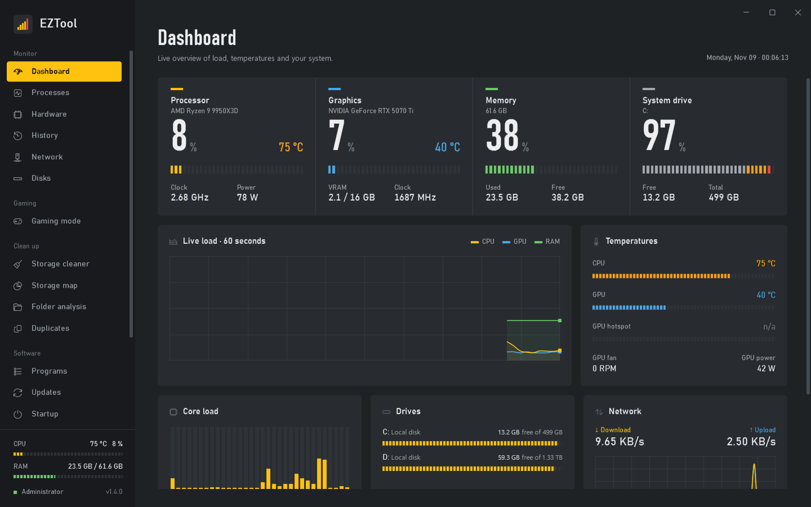

## Screenshots

| | |
|---|---|
| 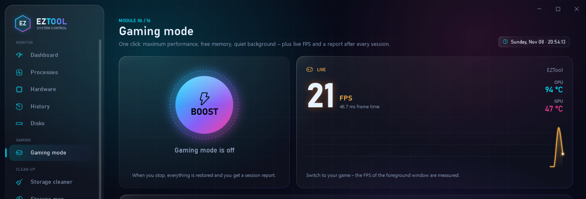 **Gaming mode**: one-click boost, live FPS, session report | 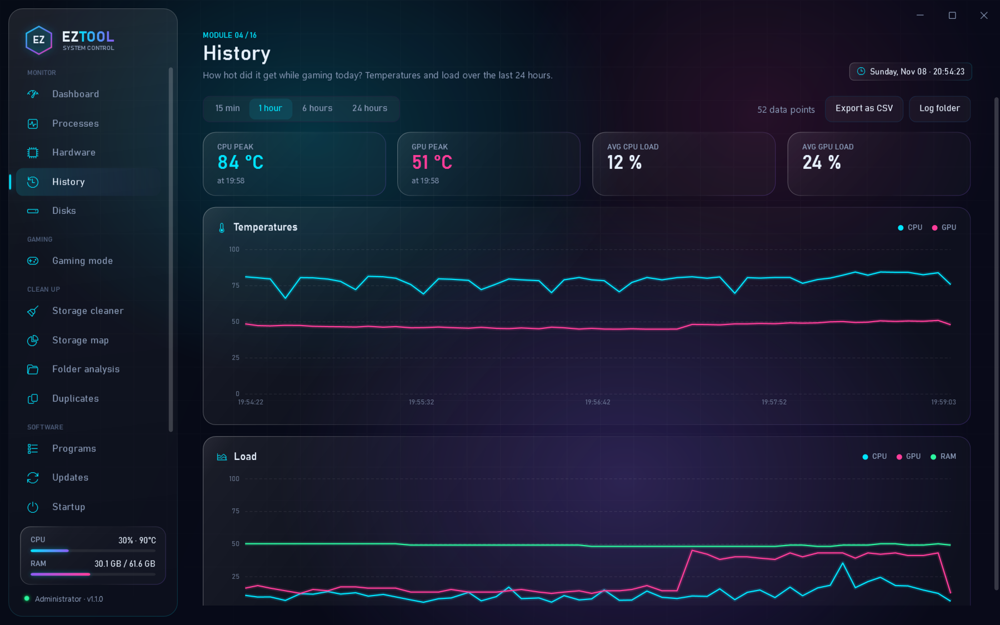 **History**: temperatures and load over the last 24 hours |
| 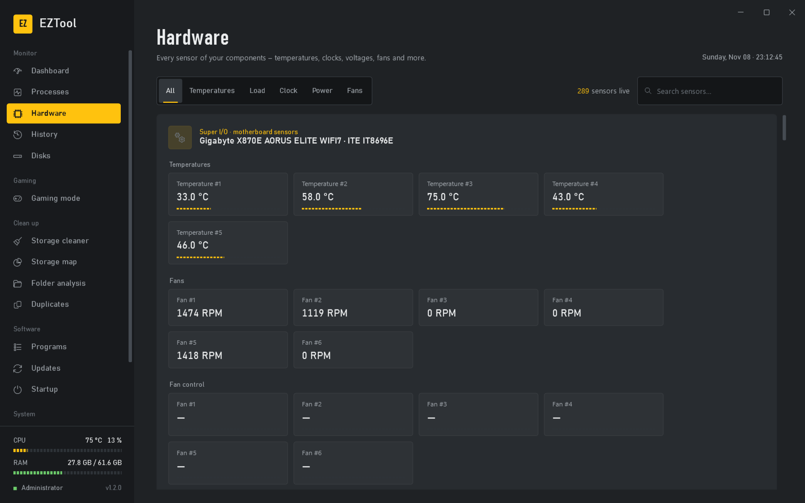 **Hardware**: every sensor live, grouped by component | 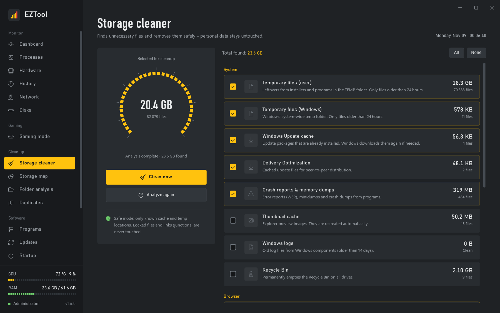 **Storage cleaner**: safe cleanup, including deep clean |
| 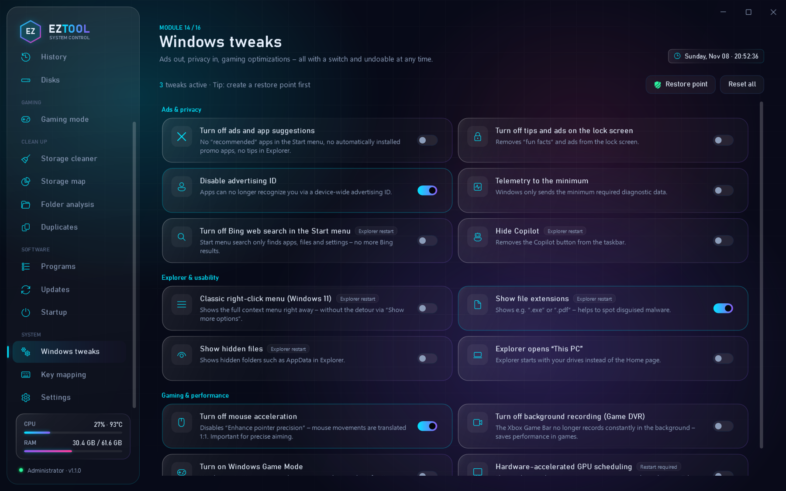 **Windows tweaks**: ads out, gaming in, everything reversible | 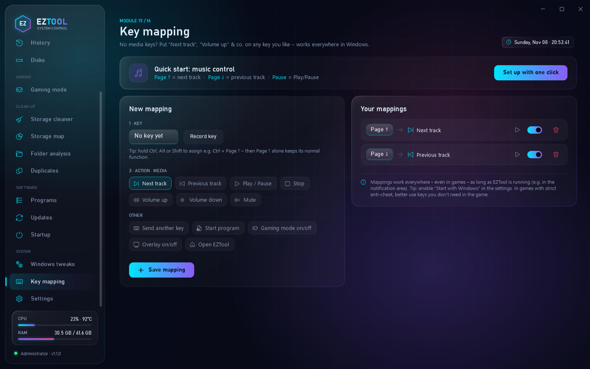 **Key mapping**: media keys for any keyboard |
| 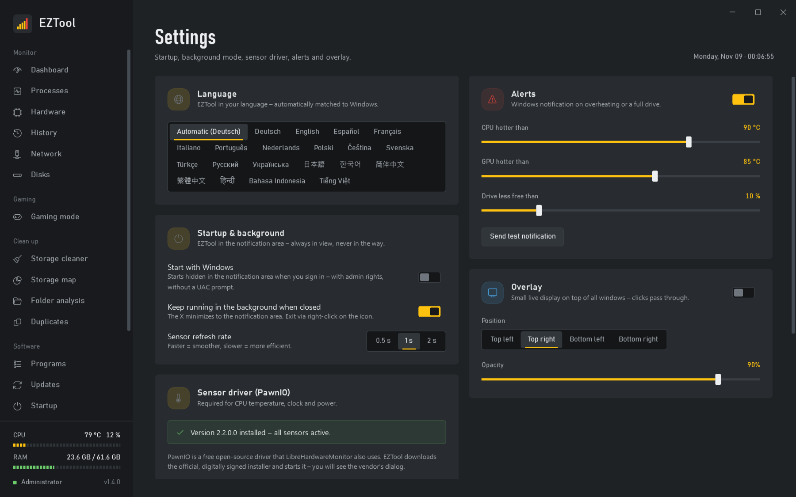 **Settings**: language, startup, alerts, overlay, auto-update | 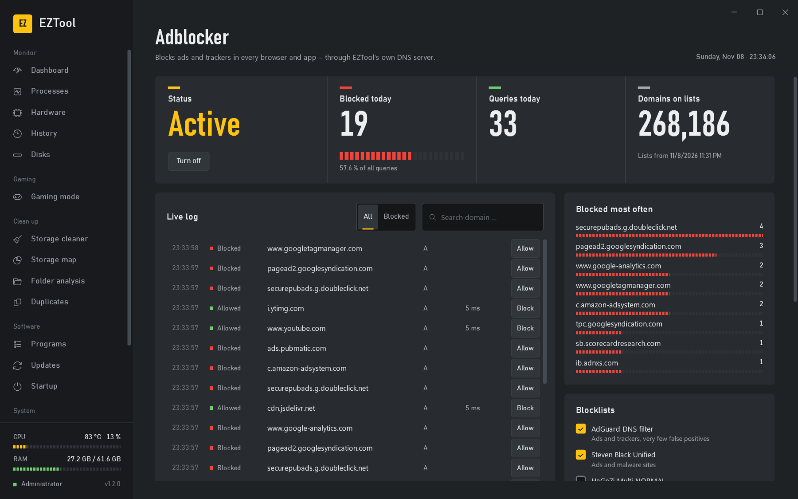 **Adblocker**: blocks ads and trackers in every browser and app |
| 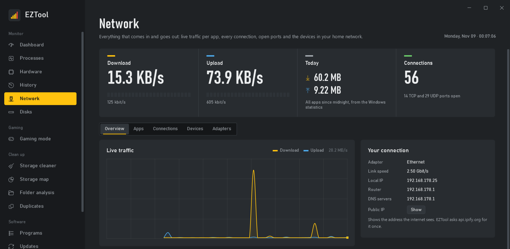 **Network**: live traffic per app, every connection, devices in your network | 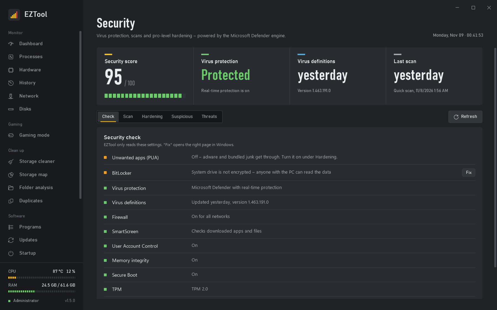 **Security**: security score, Defender scans, pro-level hardening |

## Download

1. Download **`EZTool.exe`** from [**Releases**](https://github.com/sweeax-exe/EZTool/releases/latest).
2. Run it. No installation needed, .NET is already included.

**Good to know:**
- **Administrator rights:** EZTool asks for them at startup. It needs them for temperature sensors, FPS measurement, deep clean and uninstalling.
- **SmartScreen:** On first launch Windows may show "Windows protected your PC", because the EXE has no paid code-signing certificate. Click **More info → Run anyway**. The full source code is in this repository, and every EXE is built publicly by GitHub Actions.
- **Automatic updates:** EZTool checks for new releases regularly. A yellow bar on every page announces a new version with "What's new" and a one-click update. Each update is verified via SHA-256, installed, and EZTool restarts. You can turn this off in the settings.

## 🌍 Languages

EZTool detects your Windows language automatically. You can change it any time in the settings.

Deutsch · English · Español · Français · Italiano · Português · Nederlands · Polski · Čeština · Svenska · Türkçe · Русский · Українська · 日本語 · 한국어 · 简体中文 · 繁體中文 · हिन्दी · Bahasa Indonesia · Tiếng Việt

**Contribute a language or improve a translation:**
1. Copy `src/EZTool/Localization/en` to `Localization/<code>` and translate the texts.
2. Keep placeholders like `{0}` unchanged.
3. Add the language to `Languages` in `Core/Loc.cs` and open a pull request.

If a text is missing in a language, EZTool falls back to English.

## Modules

The navigation is organized into five groups:

| Group | Module | What it does |
|---|---|---|
| Monitor | **Dashboard** | Large readouts with segmented level meters for CPU, GPU, RAM and system drive, 60-second history, temperatures, per-core load, drives, network, system info |
| | **Processes** | Processes grouped by app (e.g. "Chrome 30×"), live CPU and RAM, end with one click. Windows core processes are protected |
| | **Hardware** | Every sensor (often 150+) grouped by component, with filter and search |
| | **History** | Temperatures, load and FPS over the last 24 hours as charts with crosshair, peak values, CSV export |
| | **Network** | Live download and upload, data usage per app (today, 7 or 30 days), every connection with app, host name and traffic, open ports, devices in your home network with manufacturer, adapter details |
| | **Disks** | SSD/HDD health: remaining life, temperature, power-on hours, TB written, read/write errors |
| Gaming | **Gaming mode** | Boost button (high-performance power plan, clear standby RAM, pause Windows Update, close selected apps), live FPS, session report with average FPS, 1% low and peak temperatures |
| Clean up | **Storage cleaner** | Temp files, caches, crash dumps, browsers, Recycle Bin, plus deep clean (old Windows updates via DISM, `Windows.old`) |
| | **Storage map** | Drive as a treemap: tiles sized by space used, two levels deep, click to zoom in, right-click to go back |
| | **Folder analysis** | Large and long-unused, orphaned and empty folders |
| | **Duplicates** | Duplicate files, compared by actual content (SHA-256) |
| Software | **Programs** | Uninstall desktop programs and Store apps, then remove the leftovers |
| | **Updates** | Available updates for all programs via winget, one by one or all with one click |
| | **Startup** | Turn Run keys, startup folder entries and scheduled tasks on and off |
| System | **Security** | Security score with 12 checks (virus protection, firewall, SmartScreen, UAC, memory integrity, Secure Boot, TPM, BitLocker, Remote Desktop, SMB 1.0, Windows Update), quick, full, folder and offline scans with Microsoft Defender, ransomware protection, network protection, 16 attack surface reduction rules, suspicious unsigned programs, threat history |
| | **Windows tweaks** | 14 switches for ads, privacy, Explorer and gaming (mouse acceleration, Game DVR …), reversible any time, with restore point |
| | **Adblocker** | System-wide ad and tracker blocking through EZTool's own DNS server: blocklists (AdGuard, Steven Black, HaGeZi), live log, allow and block rules, encrypted DNS (Cloudflare, Quad9, Google) |
| | **Key mapping** | Put media functions (next/previous track, play/pause, volume), other keys, programs or EZTool actions on any key, globally, even in games. Quick start: Page ↑/↓ = next/previous track |
| | **Settings** | Language, start with Windows, background mode, sensor driver, alerts, overlay, updates |

## Design

EZTool is built like a piece of test equipment, not a sci-fi HUD: an opaque graphite housing, one **signal yellow** for everything you operate, large DIN numerals (Bahnschrift) for live values and segmented level meters with peak hold instead of glowing rings. Measurement channels use oscilloscope colors: CPU yellow, GPU blue, RAM green. All colors, fonts and control styles live in `Themes/Theme.xaml` (`Chassis`, `Panel`, `Well`, `Accent`, …).

## Running in the background

- **Tray icon:** The X minimizes EZTool to the notification area. The tooltip shows live CPU/GPU/RAM. The right-click menu opens modules, toggles the overlay and gaming mode, and exits EZTool.
- **Start with Windows:** creates a scheduled task with highest privileges. A normal Run entry would fail at UAC, because EZTool needs admin rights. The task starts EZTool hidden with `--tray`.
- **Alerts:** A Windows notification appears when the CPU or GPU exceeds its limit (after 5 readings in a row, then at most every 10 minutes) or a drive is almost full. Clicking it opens the matching module.
- **Overlay:** a small live display on top of all windows with CPU, GPU, RAM and **FPS**. Clicks pass through. Works over borderless games, not in exclusive fullscreen.
- **Sensor log:** every 5 seconds, one CSV per day in `%LOCALAPPDATA%\EZTool\Logs`. Files older than 30 days are deleted automatically.
- **Single instance:** starting EZTool a second time brings the running window to the front.

## FPS measurement

EZTool reads DirectX "Present" events via Windows ETW, the same source PresentMon uses. It measures the window in the foreground. This works with DirectX 9 to 12. Vulkan and OpenGL games are only captured if they present through DXGI. Measuring needs administrator rights and only runs while the overlay, the gaming page or gaming mode is active. Session reports are stored in `%LOCALAPPDATA%\EZTool\Sessions`.

## Key mapping

A global low-level keyboard hook (`WH_KEYBOARD_LL`) intercepts the mapped key. Its normal function is suppressed, and EZTool sends the chosen action via `SendInput` instead, for example the media key "Next track". Details:

- **No idle cost:** The hook is only active while at least one mapping is enabled.
- **No loops:** Keys EZTool sends itself are ignored.
- **Normal rights:** Programs started by a key run through Explorer with normal rights, not as administrator.
- **Storage:** Mappings are saved in `settings.json` (`KeyBindings`).

## Network

- **Live traffic per app and connection:** EZTool reads the Windows ETW source `Microsoft-Windows-Kernel-Network`. Every TCP and UDP packet arrives with process ID, size and remote address, so EZTool shows which app talks to which server and how much. Needs administrator rights and only runs while the Network page is open.
- **Host names:** remote addresses are matched with the names programs looked up (Windows DNS cache), otherwise a reverse lookup is used.
- **Data usage per app:** comes from the Windows statistics (the same numbers as Settings → Network → Data usage) for today, 7 or 30 days.
- **Open ports:** programs waiting for incoming connections, marked when they listen on all networks.
- **Devices:** the scan pings every address in your home network, reads the MAC addresses from the ARP table and asks the router for the names. The manufacturer comes from the public IEEE list (`standards-oui.ieee.org`, downloaded once). Phones with a private (random) MAC address are marked as such.
- **Public IP:** only on request, via `api.ipify.org`.

## Security

EZTool doesn't ship its own virus scanner. A homemade engine without a malware lab and a signed kernel driver would be far weaker than Microsoft Defender, which already scores top marks in independent tests. Instead EZTool turns Defender into a security centre:

- **Security check:** reads 12 Windows settings that are otherwise spread over many pages and weights them into a score. EZTool only reads them, and "Fix" opens the right Windows page.
- **Scans:** quick, full, folder or drive, and the offline scan that runs before Windows starts. They run through `MpCmdRun.exe` and can be cancelled, and signature updates on demand.
- **Hardening:** ransomware protection (controlled folder access), blocking unwanted apps (PUA), network protection, stricter cloud protection and 16 attack surface reduction rules. All are set via the official `Set-MpPreference` / `Add-MpPreference` commands and read back afterwards. If Tamper Protection blocks a change, EZTool says so and opens Windows Security.
- **Suspicious programs:** unsigned programs in folders anyone can write to (Temp, Downloads, Desktop, AppData, ProgramData) that start with Windows, are running or are online. Each can be checked with Defender in one click.
- **Threat history:** everything Defender has found, with severity, file and status, and removing active threats.

## Adblocker

The adblocker works on the DNS level, so it covers every browser and app at once:

- **How it works:** EZTool runs a small DNS server on `127.0.0.1` and `::1` (port 53) and points the DNS settings of your network adapters (Ethernet, Wi-Fi) at it. Domains on the blocklists get `0.0.0.0` as the answer. Everything else is resolved encrypted via DNS over HTTPS at the chosen provider.
- **Hidden trackers:** If an allowed domain is only a CNAME alias for a blocked one, it is blocked too.
- **Local network:** Names like `fritz.box`, printer names and private reverse lookups still go to your router.
- **Firefox:** EZTool answers the canary domain `use-application-dns.net`, so Firefox turns off its own DNS over HTTPS and uses the adblocker.
- **Safe restore:** The original DNS settings are saved to `%LOCALAPPDATA%ZToolAdBlockdns-backup.json` before anything changes. They are restored when EZTool closes, when you sign out or shut down, and on the next start after a crash. In an emergency, `EZTool.exe --restore-dns` resets them too.
- **Limits:** Ads on YouTube and Twitch come from the same servers as the videos, so DNS can't block them. While a VPN is connected, its DNS is used.
- **Lists:** downloaded from the list maintainers (AdGuard DNS filter, Steven Black Unified hosts, HaGeZi Multi NORMAL) and refreshed every 3 days.

## Safety principles

- **Cleaner:** only known cache and temp locations. Temp files only when older than 24 hours, locked files are skipped, junctions are never followed. For browsers **only** the cache is deleted. Deep clean uses Windows' own tools exclusively (DISM, Disk Cleanup).
- **Programs:** The vendor's uninstaller is always used (Store apps via the official PackageManager API). Folders of other installed programs are never suggested as leftovers. Registry keys are backed up as `.reg` first. System-relevant Store apps (Store, App Installer, Xbox Identity …) can't be removed.
- **Folders & duplicates:** Deleting always means *Recycle Bin*. System, program, dot and build folders are excluded. Cloud files (OneDrive placeholders) are never read. Duplicates are only preselected for media, and at least one copy always stays in every group.
- **Startup:** Turning an entry off uses the same mechanism as Task Manager (`StartupApproved`), so the entry stays intact. A JSON or XML backup is saved before an entry is removed permanently.
- **Processes:** Windows core processes (csrss, lsass, svchost, dwm …) can't be ended.

### CPU temperatures (PawnIO)

LibreHardwareMonitor reads CPU temperature, clock and power through the free, open-source driver **PawnIO**. If it's missing, EZTool offers to install it on first launch (and any time from the dashboard or the settings):

1. The official installer is downloaded from `github.com/namazso/PawnIO.Setup` (latest version via the GitHub API).
2. Its Authenticode signature is verified with `WinVerifyTrust`. Nothing runs without a valid signature.
3. The installer starts with its own dialog (`-install`, exactly like LibreHardwareMonitor does).
4. The sensors are reinitialized without restarting EZTool.

## Building

```bash
dotnet run --project src/EZTool
```

The app requests administrator rights (UAC).

Command-line options:
- `--page=<module>` opens a module directly (`dashboard`, `processes`, `hardware`, `history`, `disks`, `gaming`, `cleaner`, `storagemap`, `folders`, `duplicates`, `programs`, `updates`, `autostart`, `tweaks`, `hotkeys`, `settings`, `network`, `adblock`, `security`). Append `#tab` to pick a tab in screenshot mode, e.g. `network#apps`.
- `--tray` starts hidden in the notification area.
- `--lang=<code>` (or the environment variable `EZTOOL_LANG`) overrides the language, e.g. `--lang=ja`.
- Environment variable `EZTOOL_DEV=1`: a separate instance for testing that doesn't interfere with a running EZTool.
- `--screenshots=<folder> --pages=dashboard,gaming,…`: EZTool captures the listed pages itself and exits. That's how the images in `docs/screenshots` are made. Computer and user names are replaced with placeholders, input is ignored during capture, and nothing is logged.

Build the same single-file EXE as the releases locally:

```bash
dotnet publish src/EZTool -c Release -r win-x64 --self-contained true -p:PublishSingleFile=true -p:IncludeNativeLibrariesForSelfExtract=true -p:EnableCompressionInSingleFile=true -o publish
```

### Releases

GitHub Actions builds releases automatically (`.github/workflows/release.yml`). Pushing a version tag such as `v1.2.0` builds a self-contained single-file EXE (the version number comes from the tag) and publishes `EZTool.exe`, `EZTool-win-x64.zip` and `SHA256SUMS.txt`. Installed copies of EZTool pick up the update on their own.

## Extending: a new module in 2 minutes

1. Create a folder `src/EZTool/Modules/MyModule/`.
2. Write a class that implements `IModule`:

```csharp
public sealed class MyModule : IModule
{
    public string Id => "mymodule";
    public string Title => Loc.T("MyModule.Title");        // texts live in Localization/<lang>/*.json
    public string Subtitle => Loc.T("MyModule.Subtitle");
    public string Icon => "";                        // glyph from "Segoe Fluent Icons"
    public int Order => 420;                               // position (and group) in the navigation

    public FrameworkElement CreateView() => new MyModuleView { DataContext = new MyModuleViewModel() };
}
```

The module is discovered automatically and shows up in the navigation. If the view model implements `IActivatable`, `OnActivated()` is called whenever the page is opened. In XAML, texts are referenced with `{l:T MyModule.Title}` (`xmlns:l="clr-namespace:EZTool.Core"`).

**Reusable building blocks:**
- **Controls** (in `Controls/`): `RadialGauge`, `Sparkline`, `GaugeCard`, `TimeChart`, `TreemapView`
- **Styles** (in `Themes/Theme.xaml`): `Card`, `PrimaryButton`, `DangerButton`, `GhostButton`, `SegmentButton`, `Toggle`, `NeonBar`, `SearchBox`
- **Services:** `NeonDialog.Show(...)` for confirmations, `TrayService.Instance.Notify(...)` for notifications, `SettingsService` for your own settings, `Loc.T(...)` for texts

## Project structure

```
src/EZTool/
├── Assets/         App icon
├── Core/           IModule, Loc (languages), formatting, converters, Native (Recycle Bin, icons, window frame)
├── Controls/       RadialGauge, Sparkline, GaugeCard, TimeChart, TreemapView
├── Themes/         Colors, fonts, all control styles
├── Localization/   <language>/*.json – all UI texts (20 languages)
├── Services/       Hardware, Fps, Gaming, SensorLog, SystemInfo, Settings, Tray, Alerts, PawnIo, StartupTask,
│                   Update, Cleaner (+ DeepClean), DiskMap, DiskHealth, Program, StoreApp, Winget, Autostart,
│                   Process, Folder, Duplicate, Tweak, Hotkey
├── Dialogs/        NeonDialog, LeftoverDialog, OverlayWindow
└── Modules/        19 modules (Dashboard … Settings)
```

## Ideas for later

- Startup: Windows services and boot-time impact per entry
- Process details: history per process, network and disk load
- Start gaming mode automatically when a game is detected
- Choice of accent colors
- Driver update check (GPU drivers)

## License

[MIT](LICENSE). Third-party libraries: see [THIRD-PARTY-NOTICES.md](THIRD-PARTY-NOTICES.md).
